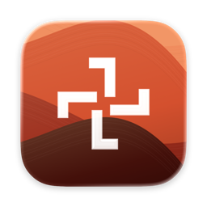
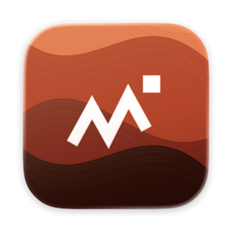
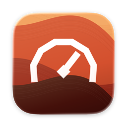
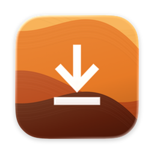
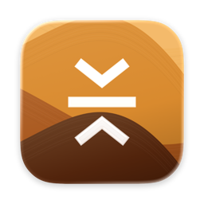
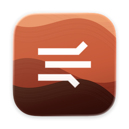
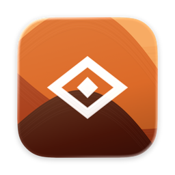
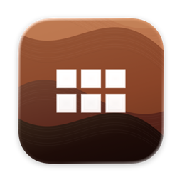
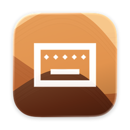

# macOS apps

Ten small native macOS apps I built for my own Mac, in Swift and SwiftUI, with no Xcode project and no dependencies. Each app is a single `main.swift` compiled with `swiftc` by a short `build.sh`, and they all share one design file (`Canyon/Canyon.swift`): terracotta, ochre and sand, like a sandstone canyon.

Built with Claude Code as a pair programmer: I design the app and decide how it should feel, then we write and iterate on it together.

| | App | What it does |
|---|---|---|
|  | **[Glisse](Glisse)** | Hold Shift while dragging a file and a conversion wheel appears: images, PDF, documents, video and audio converted in one gesture. |
|  | **[Craie](Craie)** | Draw on top of any screen with ⌥⇧D: pen, arrows, shapes, text, images, eraser, undo and redo. One transparent layer per display. |
|  | **[Jauge](Jauge)** | The state of the Mac in one word, from the menu bar. Memory pressure and swap first, then CPU and heat, grouped by app, with a button to quit the culprit. |
|  | **[Bilan Mails](BilanMails)** | Reads every mailbox in Apple Mail through AppleScript, then asks Claude Code (`claude -p`) to sort what actually matters: to-dos, meetings, money, scams. |
|  | **[Étagère](Etagere)** | A shelf in the menu bar: drop files, images or text on it, drag them back out later into any app. Handles promised files from Photos and Mail. |
|  | **[Compresseur](Compresseur)** | Drop images or PDFs and get a lighter copy next to the original. HEIC to JPEG, transparent PNGs kept, PDFs recompressed with selectable text. |
|  | **[Flow](Flow)** | One click to enter focus mode: desktop hidden under an animated canyon dusk, Dock and menu bar hidden, focus music generated live with AVAudioEngine. |
|  | **[Éveillé](Eveille)** | Keeps the Mac awake, including lid closed, with five safety nets (timer, low battery, crash recovery, a launchd guard). |
|  | **[Grille](Grille)** | ⌃⇧T opens a new empty desktop with six Terminal windows in a 3×2 grid, driven through the Accessibility API. |
|  | **[Nettoyage Clavier](NettoyageClavier)** | Locks the keyboard (keys, modifiers and media keys) while you clean it, with a countdown and several ways to never get stuck. |

## Build

Requirements: macOS 26 and Xcode (only for `actool`, which compiles the Liquid Glass icon).

```sh
cd Glisse
./build.sh   # compiles, signs ad hoc and installs into ~/Applications
```

Grille and Nettoyage Clavier ask for Accessibility permission the first time. After a rebuild, macOS may ask again.

## Notes

- The code and comments are in French, the language I think in.
- Every app is one file, on purpose: easy to read top to bottom, easy to change.

## License

MIT
